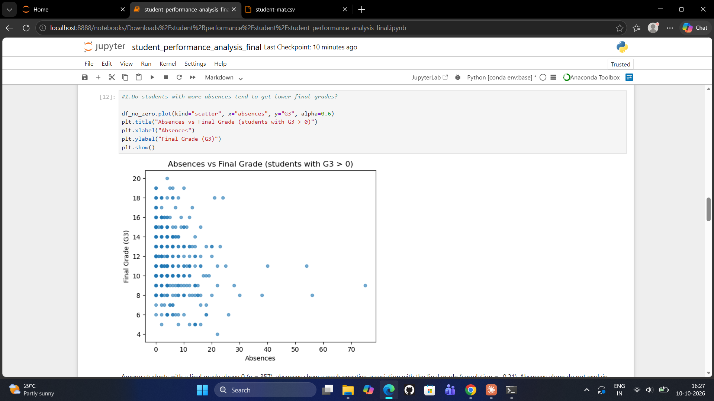
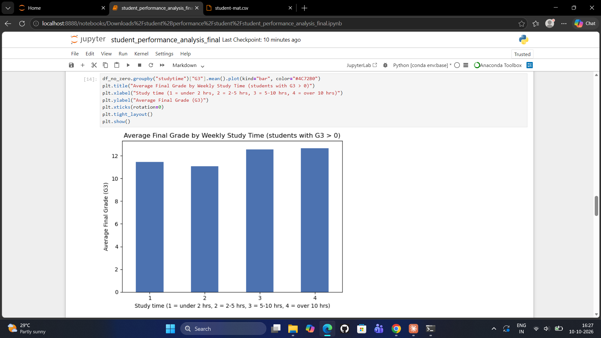
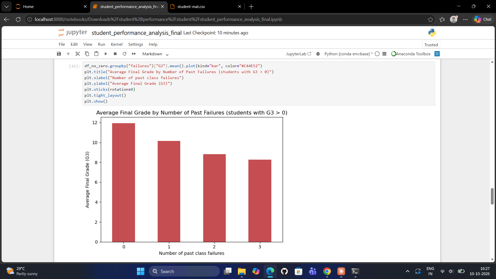

# Student Performance Analysis

An analysis of student performance using a real dataset, plus a smaller Python tool for
managing student records.

## Project 1: Analysis notebook (main project)

File: student_performance_analysis_final.ipynb

Dataset: UCI Student Performance (student-mat.csv), 395 secondary school students from
two Portuguese schools, mathematics course.

Questions answered:
1. Do students with more absences tend to get lower final grades?
2. How does study time relate to the final grade?
3. Do students with past failures perform worse?
4. What share of students pass, and what do students who don't pass have in common?

Key findings:
- 67.09% of all 395 students passed (final grade of at least 10); 74.23% when the 38
  students with a final grade of 0 are excluded.
- All 38 zero-grade students have 0 recorded absences, which hid the absences pattern.
  Excluding them, absences show a weak negative association with final grade (-0.21).
- Past failures show the strongest pattern: average final grade falls from 11.94 (no past
  failures) to 8.27 (three or more).
- Study time shows only a small, uneven difference in grades.
- A first-period grade below 10 was an early indicator: 34.2% of those students passed,
  compared with 92.3% of those who scored 10 or above.
- The pass rate depends strongly on the pass mark chosen (about 82% at 8, 67% at 10,
  41% at 12).

Methods: data checks (missing values, duplicates, zero grades), groupby comparisons,
correlation, charts with Matplotlib.

Limitations: observational data, so associations only; one course in two schools; the pass
mark of 10 is my own project rule; the reason for the zero grades is not documented.

## Project 2: Student management tool

File: student_system.py

A menu-driven Python program (pandas, Matplotlib, CSV) with add, view, search, update and
delete for student records, input validation, and analysis of averages, pass percentage,
grade distribution, at-risk students, ranking and correlation. It uses small illustrative
sample data, not real student results.

## How to run

pip install pandas matplotlib notebook

jupyter notebook student_performance_analysis_final.ipynb

python student_system.py

Keep student-mat.csv in the same folder as the notebook.

## Data source and licence

Cortez, P. (2014). Student Performance. UCI Machine Learning Repository.
Licensed under Creative Commons Attribution 4.0 International (CC BY 4.0):
https://creativecommons.org/licenses/by/4.0/legalcode
